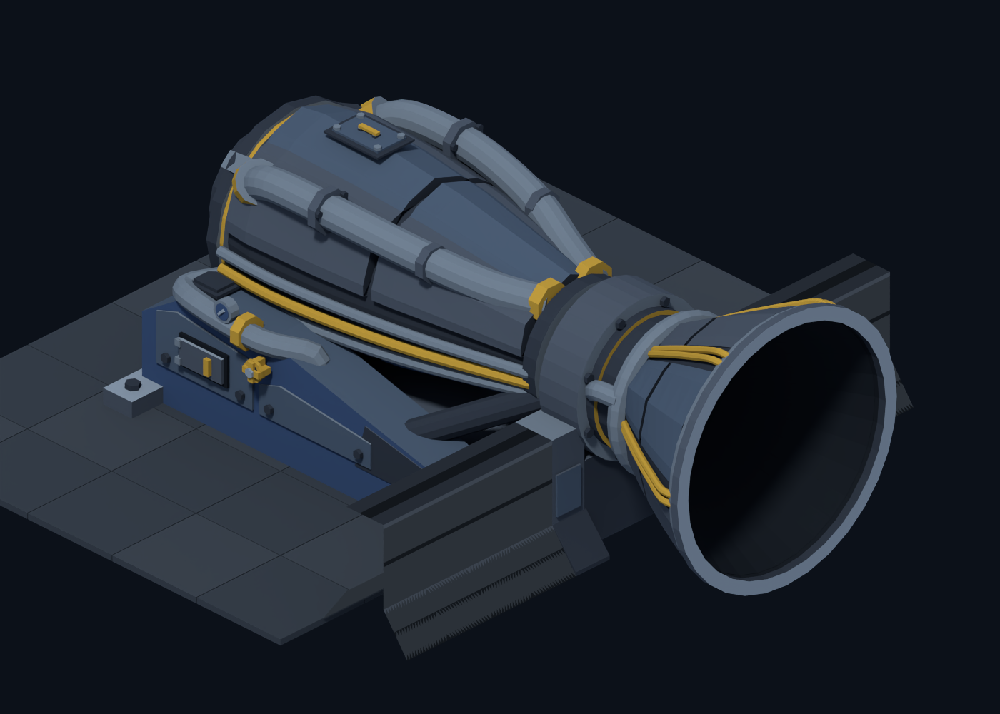
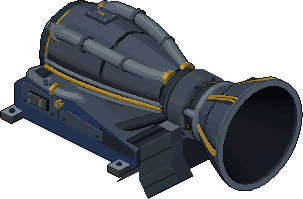

# Heavy Kestrel — approved engine art handoff

**The user approved stage 7.** This is the final design, ready for Claude to
perform the full sprite renders later. No further design pass is requested.

[Claude handoff and complete render commands](HANDOFF.md).

The engine has a heavy armoured power cassette, close-coupled feed ducts,
service lids and gauges, and a single flared bell. Its supports bolt directly
to the ship deck; it has **no separate floor/base plate**. The engine's own
armoured hull section remains full height beside cut-down neighbouring walls.

Everything in this handoff is added under this directory. It does not replace
Claude's `sprites/engine_proto.py`, review scripts, production sprite sheets,
manifest, gameplay code, or JANUS. The model uses the shared sprite primitives
and actual production wall ends; no other experimental model is required.

## Files

- `model.py`: fixed coordinate contract, hull, bell and assembly.
- `cassette.py`: approved engine body, direct deck supports and service hardware.
- `geometry.py`: generic swept tubes, rings and lathed surfaces.
- `plasma.py`: additive exhaust volume material.
- `render.py`: isolated sprite layers, manifest fragment and Blender reviews.
- `render_all.sh`: future complete render, with a fresh output directory guard.
- `present.py`: native/3x composites for all rotations; installed scenes for r0/r1.
- `validate.py`: all-rotation dimensions, deck contact, palette, alpha and glow.
- `approved/`: the existing approved view and **partial r1 idle** reference,
  with metadata and validation results. It is not a complete production atlas.

The full render has deliberately not been run as part of publishing this
handoff. The approved view is preserved; the local design-review history is
not required to rebuild it.
